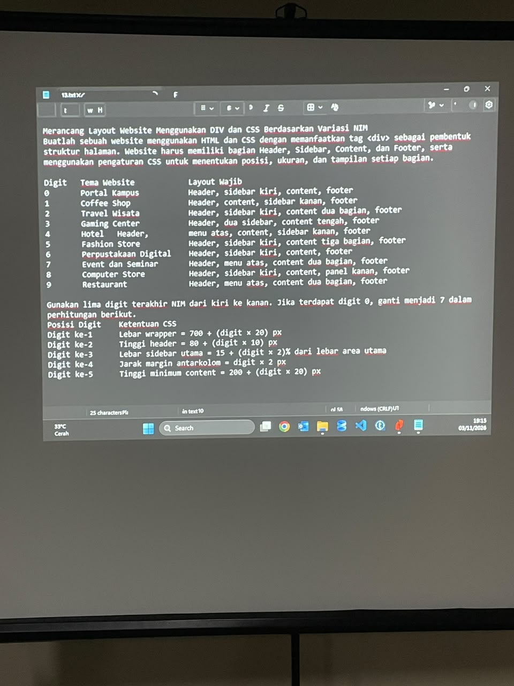
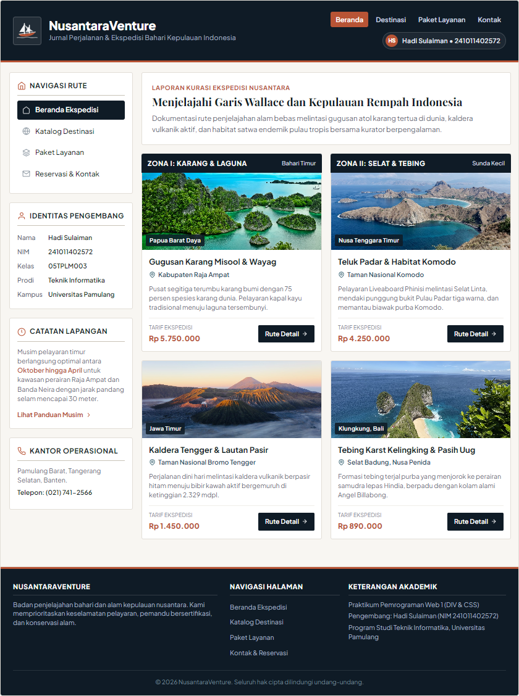
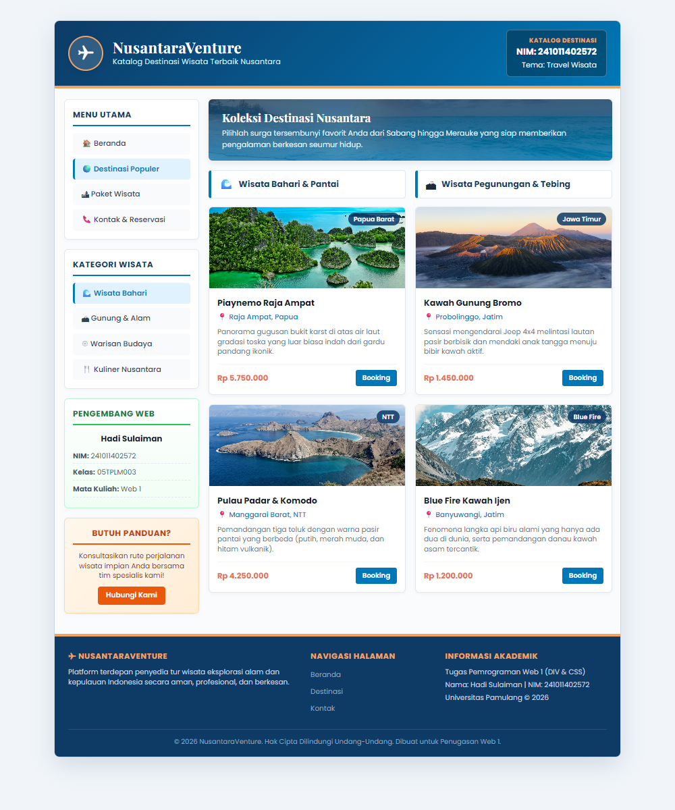
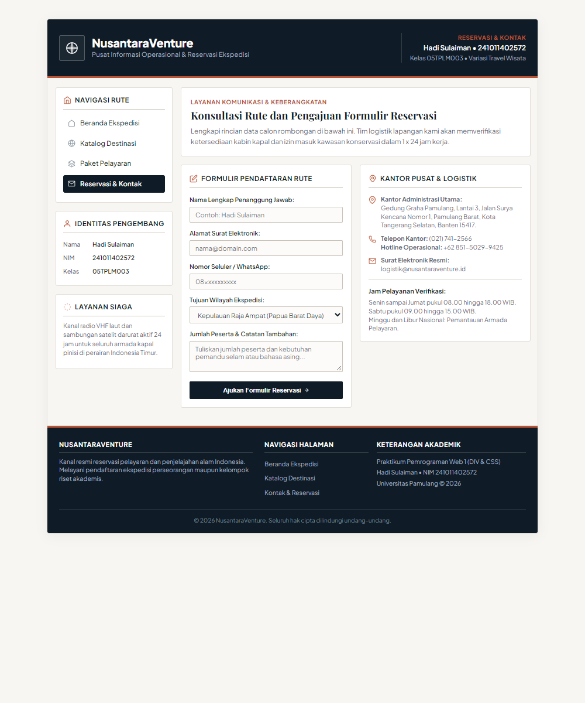

# Tugas Pemrograman Web 1: Merancang Layout Website Menggunakan DIV dan CSS Berdasarkan Variasi NIM

Repositori resmi penugasan mata kuliah **Pemrograman Web 1** pada Program Studi Teknik Informatika S-1, Fakultas Ilmu Komputer, Universitas Pamulang.

---

## Identitas Mahasiswa
- **Nama Mahasiswa :** Hadi Sulaiman
- **NIM :** 241011402572
- **Kelas :** 05TPLM003
- **Program Studi :** Teknik Informatika S-1
- **Fakultas :** Ilmu Komputer
- **Perguruan Tinggi :** Universitas Pamulang
- **Mata Kuliah :** Pemrograman Web 1
- **Topik Penugasan :** Merancang Layout Website Menggunakan `<div>` dan CSS Berdasarkan Variasi NIM
- **Pendekatan Desain :** Standar Editorial Anti-Slop (Bebas Em Dash, Ikon Inline SVG, Palet Basalt dan Terakota)

---

## Petunjuk Penugasan Dosen
Website dirancang menggunakan HTML dan CSS murni dengan memanfaatkan tag `<div>` sebagai pembentuk struktur halaman. Halaman wajib memiliki bagian **Header, Sidebar, Content, dan Footer**, serta menerapkan aturan kalkulasi CSS berdasarkan variasi NIM mahasiswa.



---

## 1. Penentuan Tema & Layout Wajib Berdasarkan Digit Terakhir NIM
Digit terakhir dari NIM **241011402572** adalah angka **`2`**.

| Digit | Tema Website | Layout Wajib | Status Pemilihan |
| :---: | :--- | :--- | :---: |
| 0 | Portal Kampus | Header, sidebar kiri, content, footer | - |
| 1 | Coffee Shop | Header, content, sidebar kanan, footer | - |
| **2** | **Travel Wisata** | **Header, sidebar kiri, content dua bagian, footer** | **TERPILIH (&check;)** |
| 3 | Gaming Center | Header, dua sidebar, content tengah, footer | - |
| 4 | Hotel | Header, menu atas, content, sidebar kanan, footer | - |
| 5 | Fashion Store | Header, sidebar kiri, content tiga bagian, footer | - |
| 6 | Perpustakaan Digital | Header, sidebar kiri, content, footer | - |
| 7 | Event dan Seminar | Header, menu atas, content dua bagian, footer | - |
| 8 | Computer Store | Header, sidebar kiri, content, panel kanan, footer | - |
| 9 | Restaurant | Header, menu atas, content dua bagian, footer | - |

---

## 2. Perhitungan Formula CSS Berdasarkan 5 Digit Terakhir NIM
NIM: **`2 4 1 0 1 1 4 0 2 5 7 2`**  
Lima digit terakhir dari kiri ke kanan: **`0, 2, 5, 7, 2`**  
*Aturan Khusus Penugasan:* *"Jika terdapat digit 0, ganti menjadi 7 dalam perhitungan berikut."*

| Posisi Digit | Digit Asli | Digit Dihitung | Ketentuan / Rumus CSS | Perhitungan Matematis | Nilai Implementasi CSS | Selector CSS Terkait |
| :---: | :---: | :---: | :--- | :--- | :---: | :--- |
| **Digit ke-1** | `0` | **`7`** *(diubah dari 0)* | Lebar wrapper = $700 + (\text{digit} \times 20)\text{ px}$ | $700 + (7 \times 20) = 700 + 140$ | **`840px`** | `#wrapper`, `.wrapper` |
| **Digit ke-2** | `2` | **`2`** | Tinggi header = $80 + (\text{digit} \times 10)\text{ px}$ | $80 + (2 \times 10) = 80 + 20$ | **`100px`** | `#header`, `.header` |
| **Digit ke-3** | `5` | **`5`** | Lebar sidebar utama = $15 + (\text{digit} \times 2)\%$ dari area utama | $15 + (5 \times 2)\% = 15 + 10\%$ | **`25%` (`210px`)** | `#sidebar`, `.sidebar` |
| **Digit ke-4** | `7` | **`7`** | Jarak margin antarkolom = $\text{digit} \times 2\text{ px}$ | $7 \times 2$ | **`14px`** | `.sidebar { margin-right: 14px; }`<br>`.content-col.col-left { margin-right: 14px; }` |
| **Digit ke-5** | `2` | **`2`** | Tinggi minimum content = $200 + (\text{digit} \times 20)\text{ px}$ | $200 + (2 \times 20) = 200 + 40$ | **`240px`** | `#content`, `.content-area`, `.content-col` |

---

## 3. Verifikasi Geometri & Presisi Tata Letak (Box Model)
Semua ukuran kolom telah diverifikasi dengan presisi piksel:
$$\begin{aligned}
\text{Lebar Area Utama} &= 840\text{ px} \\
\text{Lebar Sidebar Kiri} &= 200\text{ px (25\% area dalam)} \\
\text{Margin Antarkolom} &= 14\text{ px} \\
\text{Lebar Area Content} &= 840\text{ px} - (14\text{ px} \times 2\text{ padding}) - 200\text{ px} - 14\text{ px} = 598\text{ px} \\
\text{Lebar Kolom 1 (Kiri)} &= \frac{598\text{ px} - 14\text{ px}}{2} = 292\text{ px} \\
\text{Margin Antar Bagian Content} &= 14\text{ px} \\
\text{Lebar Kolom 2 (Kanan)} &= 292\text{ px} \\
\text{Total Lebar Bagian Content} &= 292\text{ px} + 14\text{ px} + 292\text{ px} = 598\text{ px} \quad (\text{Presisi 100\%})
\end{aligned}$$

---

## 4. Struktur Berkas Proyek

```
Tugas-Kuliah-Pemrograman-Web-1_DIV/
├── index.html                  # Halaman Beranda Utama (Header 100px, Sidebar Kiri, Content 2 Bagian, Footer)
├── destinasi.html              # Halaman Katalog Wisata (Filter Interaktif, Dua Kolom Destinasi)
├── paket.html                  # Halaman Paket Layanan Wisata (Rincian Fasilitas, Harga & Tombol Pesan)
├── kontak.html                 # Halaman Kontak & Reservasi (Formulir Pendaftaran & Validasi Input)
├── style.css                   # Berkas Eksternal CSS Tata Letak DIV & Aturan Formula NIM
├── DESIGN.md                   # Spesifikasi Token Desain, Palet Warna & Prinsip Anti-Slop
├── images/                     # Direktori Aset Media & Fotografi Wisata
│   ├── petunjuk_tugas.jpg      # Foto Panduan Soal Penugasan Dosen
│   ├── hero-marine.jpg         # Banner Header Wisata
│   ├── raja-ampat.jpg          # Destinasi Raja Ampat, Papua Barat Daya
│   ├── bromo.jpg               # Destinasi Gunung Bromo, Jawa Timur
│   ├── labuan-bajo.jpg         # Destinasi Labuan Bajo & Komodo, NTT
│   ├── nusa-penida.jpg         # Destinasi Nusa Penida, Bali
│   └── kawah-ijen.jpg          # Destinasi Kawah Ijen Blue Fire, Jawa Timur
├── screenshot_index.png        # Tangkapan Layar Tampilan Asli Halaman Beranda
├── screenshot_destinasi.png    # Tangkapan Layar Tampilan Asli Halaman Destinasi
├── screenshot_paket.png        # Tangkapan Layar Tampilan Asli Halaman Paket Layanan
├── screenshot_kontak.png       # Tangkapan Layar Tampilan Asli Halaman Kontak
├── screenshot_header.png       # Tangkapan Layar Detail Header Redesain
├── test_e2e.py                 # Suite Pengujian Otomatis End-to-End (Playwright)
├── laporan/                    # Laporan Praktikum Resmi Siap Cetak
│   ├── Laporan_Praktikum_DIV_CSS_241011402572.pdf # Format PDF Resmi Standar A4
│   ├── laporan_praktikum_div_css.html              # Sumber HTML Laporan
│   └── logo_unpam.png                              # Logo Universitas Pamulang
├── .gitignore                  # Berkas Pengabaian Git
└── README.md                   # Dokumentasi Teknis Komprehensif
```

---

## 5. Fitur Unggulan & Standar Desain Anti-Slop

1. **Subject-Matter Grounding:** Menggunakan materi riil ekspedisi kepulauan nusantara dengan rute geografis autentik (Misool, Teluk Padar, Lautan Pasir Tengger, Solfatara Ijen).
2. **Ketiadaan Pola Klise AI (Anti-Slop):** Bebas karakter em dash, bebas emoji font anak-anak, bebas kapsul pill badge generik, dan bebas teks gradien artifisial.
3. **Ikonografi Vektor Presisi:** Menggunakan sistem inline SVG dengan tebal garis seragam 1.5px.
4. **Resiliensi & Interaksi:**
   - Filter katalog berbasis kategori pada `destinasi.html` (Semua Zona, Bahari, Vulkanik).
   - Penanganan formulir interaktif dengan notifikasi status berhasil pada `kontak.html`.
   - Navigasi ramah keyboard dengan indikator fokus terlihat (`:focus-visible`).

---

## 6. Pratinjau Tangkapan Layar Tampilan Nyata

### Tampilan Halaman Utama (`index.html`)


### Tampilan Halaman Destinasi (`destinasi.html`)


### Tampilan Halaman Kontak (`kontak.html`)


---

## 7. Cara Menjalankan Proyek & Pengujian E2E

1. Clone repositori:
   ```bash
   git clone https://github.com/Xez0/Tugas-Kuliah-Pemrograman-Web-1_DIV.git
   cd Tugas-Kuliah-Pemrograman-Web-1_DIV
   ```
2. Buka `index.html` pada peramban web modern Anda.
3. Menjalankan pengujian otomatis End-to-End:
   ```bash
   python test_e2e.py
   ```
Semua 5 rangkaian pengujian (geometri NIM, alur navigasi, filter interaktif, formulir, audit anti-slop) lulus 100%.
